<p align="center">
  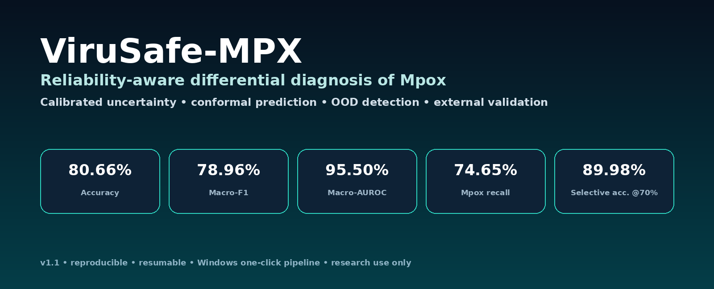
</p>

<h1 align="center">🛡️ ViruSafe-MPX</h1>
<p align="center"><b>Reliability-aware, uncertainty-calibrated and explainable AI for differential Mpox screening</b></p>

<p align="center">
  <a href="LICENSE"></a>
  
  
  
  
  
</p>

<p align="center">
  <a href="#-results-at-a-glance">Results</a> •
  <a href="#-one-click-reproduction">One-click reproduction</a> •
  <a href="#-architecture">Architecture</a> •
  <a href="docs/RESULTS.md">Detailed results</a> •
  <a href="docs/REPRODUCIBILITY.md">Reproducibility</a> •
  <a href="CITATION.cff">Cite</a>
</p>

---

## 🔬 What is ViruSafe-MPX?

**ViruSafe-MPX** is a research framework for six-class differential screening of **Mpox, chickenpox, measles, cowpox, hand-foot-and-mouth disease (HFMD), and healthy skin**. Instead of optimizing only headline accuracy, it explicitly models **uncertainty, abstention, conformal prediction, out-of-distribution (OOD) behavior, explainability, robustness, and external validation**.

The repository reproduces the code path used for the associated IEEE ESCI 2027 manuscript. The v1.1 enhancement reuses five trained EfficientNetV2-S checkpoints and adds a **frozen-feature reliability head** without retraining the CNN.

> [!IMPORTANT]
> This is a **retrospective research prototype**, not a clinical diagnostic device. Outputs must not replace clinician assessment or confirmatory PCR testing.

<p align="center">
  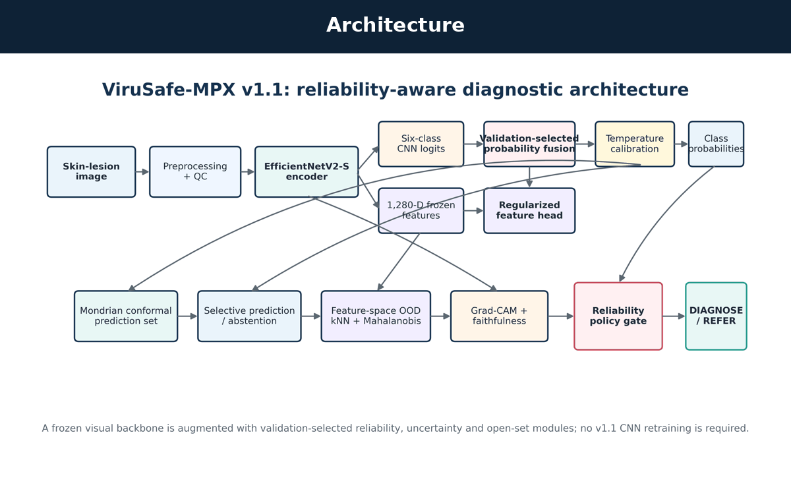
</p>

## ✨ Highlights

- 🧠 **EfficientNetV2-S** six-class visual backbone.
- 🧩 **1,280-D frozen-feature reliability head** with grouped inner-CV hyperparameter selection.
- 🎚️ Validation-selected **CNN + reliability-head fusion** and temperature recalibration.
- 🛑 **Selective prediction** / abstention for uncertain cases.
- 🎯 **Mondrian class-conditional conformal prediction** for set-valued uncertainty.
- 🌐 Feature-space **OOD detection** with cosine k-NN + PCA-Mahalanobis fusion.
- 🔍 Test-only **Grad-CAM** plus deletion-faithfulness analysis.
- 🧪 Controlled corruption tests for blur, brightness, JPEG, occlusion and Gaussian noise.
- 🌍 **Duplicate-filtered external validation** on MSID.
- 📊 Paired group-cluster bootstrap confidence intervals and exact **McNemar** significance testing.
- ♻️ **Fully resumable execution**: datasets, epochs, folds, predictions and v1.1 caches survive interruption.

## 📈 Results at a glance

<table>
<tr><th>Metric</th><th>Baseline</th><th>ViruSafe-MPX v1.1</th><th>Change</th></tr>
<tr><td>Accuracy</td><td>73.51%</td><td><b>80.66%</b></td><td>+7.15 pp</td></tr>
<tr><td>Macro-F1</td><td>72.92%</td><td><b>78.96%</b></td><td>+6.03 pp</td></tr>
<tr><td>Macro-AUROC</td><td>94.25%</td><td><b>95.50%</b></td><td>+1.25 pp</td></tr>
<tr><td>Mpox recall</td><td>55.63%</td><td><b>74.65%</b></td><td>+19.01 pp</td></tr>
<tr><td>ECE ↓</td><td>4.44%</td><td><b>3.65%</b></td><td>−0.79 pp</td></tr>
<tr><td>Brier ↓</td><td>0.380</td><td><b>0.298</b></td><td>−0.082</td></tr>
</table>

Additional safety-oriented results:

| Evaluation | Result |
|---|---:|
| Selective accuracy @ ~70% coverage | **89.98%** |
| Selective accuracy @ ~90% coverage | **84.71%** |
| Mondrian conformal coverage (nominal 90%) | **92.05%** |
| Held-out-category OOD AUROC | **0.762 ± 0.058** |
| External MSID restricted 4-class accuracy | **76.42%** |
| External Mpox F1 | **83.54%** |
| McNemar exact p-value | **1.13 × 10⁻⁹** |

<p align="center">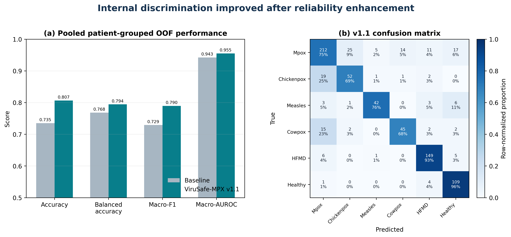</p>

## 🩺 Visual disease space

The framework studies six visually overlapping categories. The montage below is included for **research orientation only** and must not be interpreted as a clinical diagnostic atlas. Source-image rights remain with the original image/dataset owners.

<p align="center">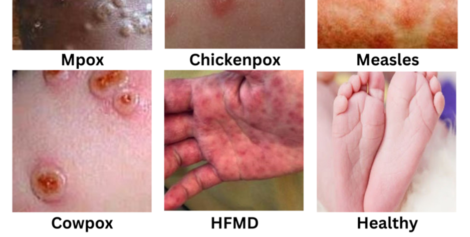</p>

## 🧠 Architecture

<p align="center">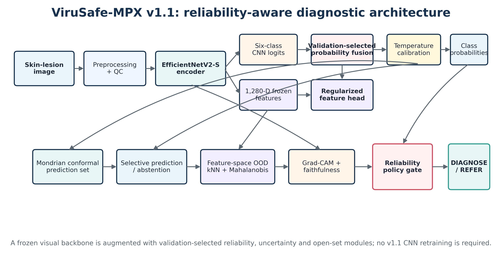</p>

The prediction path is deliberately **bounded**: calibrated class probabilities are accompanied by selective prediction, conformal sets, OOD warning signals and a mandatory referral path for ambiguous cases. See [`docs/ARCHITECTURE.md`](docs/ARCHITECTURE.md).

<p align="center">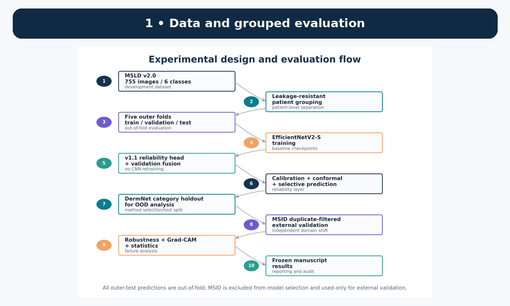</p>

## 🚀 One-click reproduction

### Windows — recommended

1. Download/clone this repository.
2. Optional but recommended for Kaggle reliability: place `kaggle.json` in `%USERPROFILE%\.kaggle\kaggle.json`.
3. Double-click:

```text
RUN_VIRUSAFE_MPX.bat
```

The launcher automatically creates a local Python 3.11 environment, installs CUDA-enabled PyTorch, downloads the required datasets, trains/evaluates the five folds, and then runs the v1.1 reliability/external-validation stage.

> [!TIP]
> If the laptop shuts down or execution is interrupted, **run the same BAT again**. Completed work is preserved and reused.

### Stage-specific execution

```text
RUN_BASE_v1.0.4.bat        # base 5-fold training + evaluation
RUN_RELIABILITY_v1.1.bat   # v1.1 enhancement; reuses base checkpoints
```

Environment diagnostic:

```bash
.venv\Scripts\python.exe scripts\doctor.py
```

## 📁 Repository map

```text
ViruSafe-MPX/
├── RUN_VIRUSAFE_MPX.bat          # full one-click resumable execution
├── RUN_BASE_v1.0.4.bat           # base stage only
├── RUN_RELIABILITY_v1.1.bat      # v1.1 stage only
├── run_pipeline.py                # base orchestrator
├── run_v11.py                     # reliability/external-validation orchestrator
├── config.yaml                    # base protocol
├── config_v1.1.yaml               # locked v1.1 protocol
├── src/                           # base implementation
├── src_v11/                       # v1.1 reliability implementation
├── results/
│   ├── figures/                   # manuscript-ready figures
│   ├── tables/                    # frozen aggregate result tables
│   └── summaries/                 # JSON/Markdown summaries + protocol lock
├── assets/                        # GitHub hero + animated walkthroughs
├── docs/                          # architecture, results, licenses, reproducibility
├── paper/                         # conference manuscript / citation note
└── .github/                       # CI + issue/PR templates
```

## 🗂️ Data protocol

| Dataset | Role | Leakage guardrail |
|---|---|---|
| **MSLD v2.0** | six-class development and grouped out-of-fold testing | patient/group-aware splits + duplicate audit |
| **DermNet** | OOD method selection and held-out-category test | disjoint category subsets; never used to train classifier |
| **MSID** | external validation only | exact SHA-256 + perceptual-hash duplicate filtering vs MSLD |

Dataset images are **not redistributed** in this repository. See [`docs/DATASETS_AND_LICENSES.md`](docs/DATASETS_AND_LICENSES.md).

## 🛡️ Reliability, not just accuracy

<p align="center">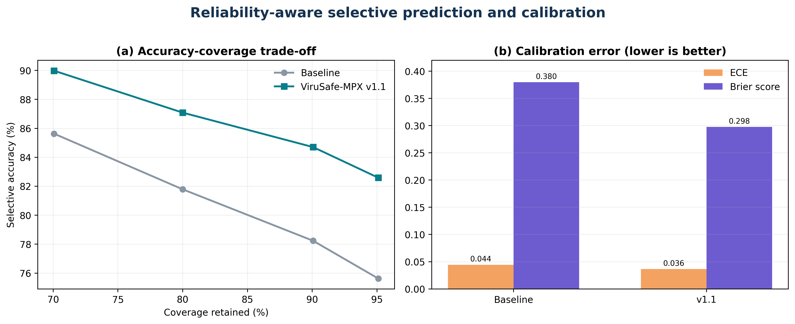</p>

At approximately 70% retained coverage, selective accuracy reaches **89.98%**. Mondrian conformal prediction obtains **92.05%** empirical overall coverage at a nominal 90% target. The OOD component improves separation of unfamiliar dermatology images, but its operating-point performance is intentionally reported as a **warning signal rather than an autonomous gate**.

<p align="center">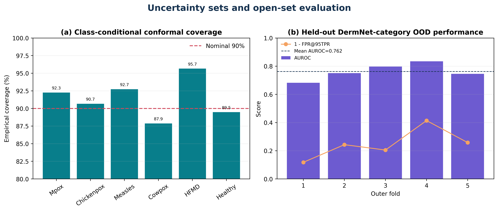</p>

## 🌍 External validation

The MSID evaluation is performed only after exact/perceptual duplicate filtering against the development data. **653** external images remained after the audit.

<p align="center">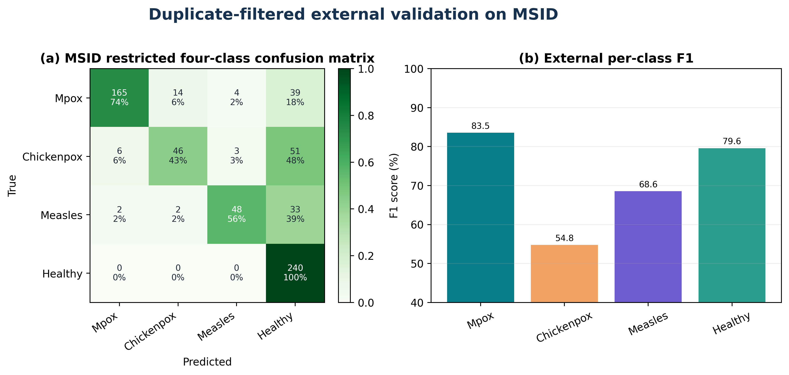</p>

## 🔍 Explainability and robustness

<p align="center">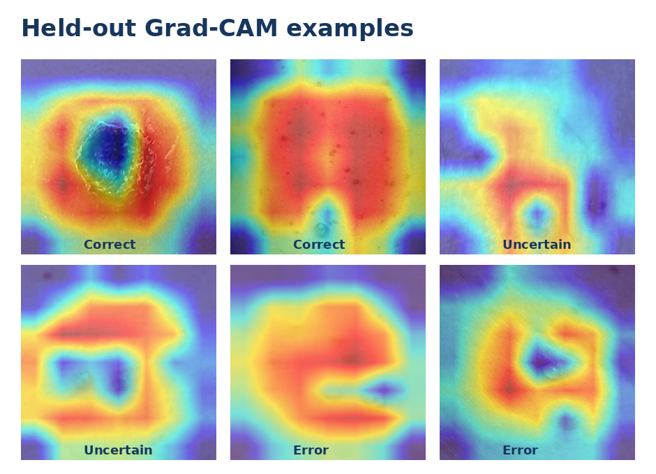</p>

Grad-CAM visualizations are restricted to held-out test examples. Deletion faithfulness compares confidence changes after CAM-guided masking with equally sized random masks. Robustness tests expose sensitivity to acquisition degradation, especially severe Gaussian noise.

<p align="center">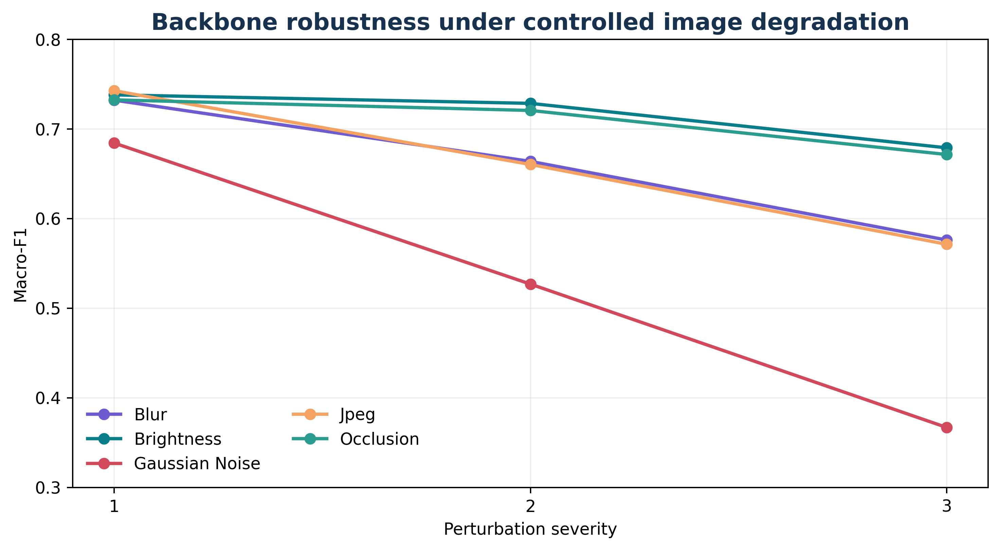</p>

## 📊 Frozen manuscript-ready outputs

The repository ships aggregate outputs from the completed v1.1 experiment so readers can inspect the reported numbers without rerunning multi-hour training:

- [`results/tables/`](results/tables/) — CSV + Excel result tables.
- [`results/summaries/results_summary_v1.1.json`](results/summaries/results_summary_v1.1.json) — machine-readable headline results.
- [`results/summaries/MANUSCRIPT_READY_RESULTS_v1.1.md`](results/summaries/MANUSCRIPT_READY_RESULTS_v1.1.md) — manuscript-oriented summary.
- [`results/summaries/PROTOCOL_LOCK_v1.1.json`](results/summaries/PROTOCOL_LOCK_v1.1.json) — pre-specified v1.1 selection rules.
- [`docs/results_report.html`](docs/results_report.html) — generated HTML report.

Datasets, CNN checkpoints, caches and local-path prediction manifests are intentionally excluded from Git.

## 🧪 Reproducibility guardrails

- Outer test labels are **not used** to fit the v1.1 feature-head hyperparameters.
- OOD methods are selected on **different DermNet categories** from the held-out OOD test categories.
- MSID is **external-only** and duplicate-filtered against MSLD before scoring.
- v1.1 does **not retrain** the CNN; it reuses the five independently trained base checkpoints.
- A protocol-lock artifact records candidate grids and selection rules.

## 📝 Paper

**ViruSafe-MPX for Reliability-Aware Differential Diagnosis of Mpox with Calibrated Uncertainty and External Validation**  
Prepared for **IEEE ESCI 2027**.

See [`paper/README.md`](paper/README.md). 

## 👥 Authors

| Author | Role | ORCID |
|---|---|---|
| **Alok Raj*** | First & corresponding author | [0009-0003-7870-7065](https://orcid.org/0009-0003-7870-7065) |
| **Pankaj Vaidya** | Co-author, Professor | [0000-0003-1304-630X](https://orcid.org/0000-0003-1304-630X) |
| **Anurag Rana** | Co-author, Professor | [0000-0003-0247-8908](https://orcid.org/0000-0003-0247-8908) |

**Affiliation:** Yogananda School of AI, Computers and Data Sciences, Shoolini University, Solan, Himachal Pradesh, India.

## 📚 Citation

GitHub will automatically expose the repository citation from [`CITATION.cff`](CITATION.cff). Until the conference paper receives its final bibliographic record, cite the software release as:

```bibtex
@software{raj_virusafe_mpx_2026,
  author  = {Raj, Alok and Vaidya, Pankaj and Rana, Anurag},
  title   = {ViruSafe-MPX: Reliability-Aware Mpox Differential Diagnosis},
  year    = {2026},
  version = {1.1.0},
  url     = {https://github.com/Mind-Twister-Wizard/ViruSafe-MPX}
}
```

## ✅ Repository self-check

Before publishing a release, run:

```bash
python scripts/verify_repo.py
python scripts/print_results.py
```

On Windows, after the local environment exists:

```text
.venv\Scripts\python.exe scripts\doctor.py
```

The GitHub Actions workflow in `.github/workflows/ci.yml` also performs lightweight syntax/repository checks without downloading medical datasets.

<details>
<summary><b>What is intentionally not stored in Git?</b></summary>

- Kaggle/DermNet source datasets
- Personal Kaggle credentials or API tokens
- Multi-gigabyte training checkpoints and temporary caches
- Patient/local-machine absolute paths
- Any source image whose redistribution rights are unclear

The one-click runner recreates the local research environment and downloads permitted source datasets from their original providers.
</details>

## ⚖️ License and responsible use

The **software** is released under the [MIT License](LICENSE). Dataset images and third-party visual assets remain subject to their original licenses and rights. This project is intended for **research and screening-method evaluation only** and makes no claim of clinical diagnostic readiness.

---

<p align="center"><b>Reliable AI should know when to predict — and when to defer.</b></p>
