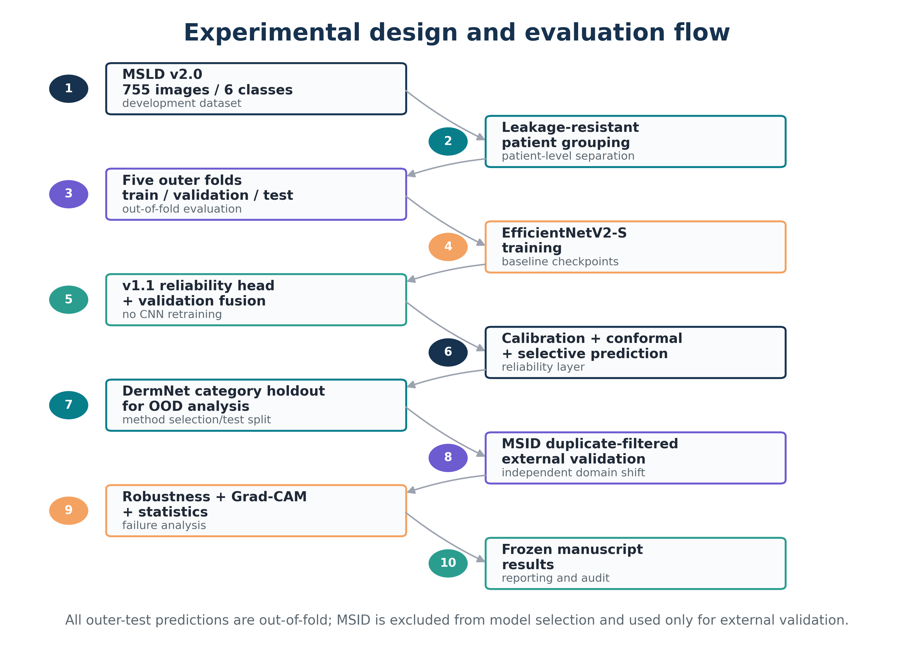

# Architecture

ViruSafe-MPX is a bounded screening framework, not an autonomous diagnostic device.

The `EfficientNetV2-S` visual encoder feeds the original CNN classifier and a 1,280-dimensional frozen feature vector. v1.1 trains a regularized multinomial feature head using training-only grouped cross-validation. The CNN probability vector and reliability-head probability vector are mixed with a validation-selected weight, then temperature-calibrated. The reliability layer adds:

1. selective prediction / abstention;
2. class-conditional Mondrian conformal prediction;
3. feature-space OOD scoring using cosine k-NN and PCA-Mahalanobis fusion; and
4. held-out Grad-CAM auditing with deletion faithfulness.

